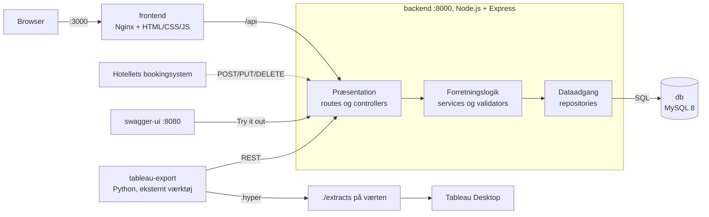

# Hotel Kong Arthur dataanalyse-platform

Prototype, der samler hotel- og bardata, håndterer bookinger, beregner nøgletal og leverer dem til et Tableau-dashboard. Backenden er bygget i tre lag med et REST/JSON-API, MySQL og Docker.

## Arkitektur



| Service | Port | Rolle |
|---|---|---|
| `db` | Kun internt | MySQL 8. Indlæser `db/01`, `02` og `03` ved første opstart |
| `backend` | 8000 | REST API. Starter først, når `db` er sund |
| `frontend` | 3000 | Bookingside. Nginx sender `/api` videre til backenden |
| `swagger-ui` | 8080 | Viser `openapi/openapi.yaml` |
| `tableau-export` | Ingen | Skriver `extracts/tableau_data.hyper` hvert 60. sekund |

Containerne finder hinanden med servicenavne på netværket `hk-network`, fx `backend:8000` og `db:3306`.

## Kom i gang

Du skal bruge Docker Desktop.

```powershell
Copy-Item .env.example .env   # skift derefter de to adgangskoder
docker-compose up --build
```

Første opstart kan tage flere minutter, fordi billeder hentes, og databasen oprettes.

- Booking: http://localhost:3000
- API: http://localhost:8000
- Swagger UI: http://localhost:8080

Kør hele kontrollen fra en ren database (sletter data i databasen):

```powershell
powershell -ExecutionPolicy Bypass -File scripts\verificer.ps1
```

Testene alene kører med `docker-compose exec backend npm test`.

## Data ved nedlukning

| Kommando | Hvad sker der |
|---|---|
| `docker-compose down` | Containerne stoppes. Data bliver i volumen `mysql_data`, og nye bookinger bevares |
| `docker-compose down -v` | Volumen slettes. Nye bookinger er væk, og `db/`-filerne indlæses igen ved næste `up` |

`db/`-filerne indlæses kun, når databasen er tom. Ændringer i dem kræver derfor `docker-compose down -v`.

## Live-data

En ændring via POST, PUT eller DELETE kan ses i næste GET uden caching, fordi hvert kald læser direkte fra MySQL. Det verificeres i `backend/tests/live-data.test.js`.

Tableau er ikke live på samme måde. Eksporten kører hvert 60. sekund (`EXPORT_INTERVAL_SECONDS=60`), og derefter skal datakilden genindlæses manuelt i Tableau. Dashboardet er altså ikke real-time.

## Tableau

```powershell
docker-compose run --rm tableau-export python hyper_extract.py --once  # opdaterer filen med det samme
```

Eksporten starter med `docker-compose up`. Åbn `extracts/tableau_data.hyper` i Tableau Desktop. Scriptet henter alt fra REST API'et og har hverken forretningslogik eller databaseadgang.

## Nøgletal

Alle formler ligger i `backend/src/business/`. Definitionerne står i `specs/hotel-kong-arthur/spec.md` (BR-01 til BR-10), og RevPAR og ADR er beskrevet i `specs/hotel-kong-arthur/notes.md`.

- **Cocktail og kaffe:** omsætningsandelen er hovedtallet og enhedsandelen et supplement (BR-07). Nævneren er den samlede omsætning eller det samlede antal enheder.
- **Værelsesindtjening:** `GET /api/metrics/revenue?group_by=type|season|country|year|type_season`.
- **Årets indtjening:** `GET /api/metrics/revenue/annual?aar=2025` giver 11234034,00 DKK. Uden `aar` bruges `HISTORIK_AAR`.
- **Kundetilfredshed:** ratings fra 1 til 5 indtastes pr. booking på bookingsiden eller med `POST /api/bookings/{id}/satisfaction`.
- **Løbende indtjening:** `GET /api/metrics/revenue/running` tæller kun nye bookinger, så en demo-booking kan ses med det samme. Tallet står også på bookingsiden.

## Kendte begrænsninger

- **Ingen login:** prototypen har bevidst ingen login, roller eller adgangskontrol (NFR-10). Alle kan skrive til API'et.
- **Historiske ophold har ingen datoer:** `stays` har kun `days_rented` og `season`. Belægning, RevPAR og ADR bygger derfor kun på nye bookinger.
- **Ingen historiske ratings:** kundetilfredshed bygger kun på de ratings, der indtastes på bookingsiden.
- **Samtidige bookinger:** to bookinger i samme øjeblik kan i teorien begge komme igennem dobbeltbooking-tjekket.

## Antagelser til underviseren

Dataene mangler noget, som systemet har brug for. Disse tal er vores antagelser, ikke hotellets rigtige data:

| Antagelse | Værdi | Hvor |
|---|---|---|
| Værelser pr. type | De 214 værelser er fordelt efter antal ophold pr. type: Grand Lit 25, Junior Suite 29, LOFT Suite 22, Spa Executive 30, Standard Double 25, Standard Single 25, Suite 29, Superior Double 29 | `db/04_rooms_seed.sql` |
| Kapacitet pr. type | Hotellets oplysninger, højst 4 som i opgaven: Standard Single 1, Grand Lit 2, Standard Double 2, Superior Double 3, Junior Suite 4, Spa Executive 2, Suite 4, LOFT Suite 4 (hotellet siger 5) | `db/04_rooms_seed.sql` |
| År for historiske ophold og barsalg | 2025 | `HISTORIK_AAR` i `.env` |
| Barsalg | Alt salg regnes som Helene Christines | `backend/src/business/services/cocktailService.js` |

Med denne kapacitet er der plads til 592 gæster, hvor opgaven siger ca. 428.

Alle beslutninger og antagelser står i `docs/beslutninger.md`.
