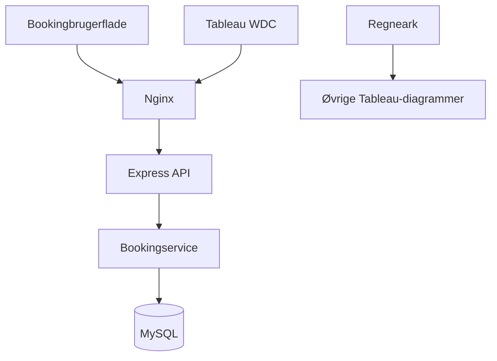

# Hotel Kong Arthur

Studieprojekt om bookingadministration og visualisering af hotel- og bardata.
Projektet består af en browserbaseret bookingprototype, et REST API, MySQL og
et Tableau-dashboard.

**Gruppe:** Kenadid, Jonas, Jazmin, Nikolaj og Jannick.

## Status

Kontrolleret 29. oktober 2026 mod `main` og `Jazmin`.

De rettede projektdokumenter ligger på `main`. Den gennemgåede booking- og
Tableau-POC ligger på `Jazmin` ved commit `c312835` og er endnu ikke samlet på
`main`. Opstartsvejledningen nedenfor gælder denne POC-kode. Kontrollér, at
`compose.yaml`, `frontend/nginx.conf`, `frontend/tableau.html` og
`frontend/tableau.js` findes, før I følger den.

| Del | Nuværende status |
|---|---|
| Bookingadministration | Opret, vis, ret og slet gennem browseren og API'et. |
| MySQL | Gemmer bookinger i en navngiven Docker-volumen. |
| Inputvalidering | Kontrollerer navn, e-mail, værelsesnummer, datoer og status. |
| OpenAPI og Swagger UI | Dokumenterer booking-endpoints. |
| Docker Compose | Starter database, backend og frontend. |
| Tableau-forbindelse | Egen Web Data Connector henter bookinger fra API'et ved manuel Refresh. |
| Dashboard | Viste hotel- og bardiagrammer bruger regneark; bookingtallet bruger API-data. |

Det samlede projekt er ikke færdigt. Analyse-endpoints, den fulde trelagsopdeling
og hele dashboardets datagrundlag gennem MySQL/API mangler fortsat.

## Teknologi og arkitektur

- **Backend:** JavaScript, Node.js og Express.
- **Database:** MySQL 8.0 med `mysql2`.
- **Frontend:** HTML, CSS og JavaScript serveret af Nginx.
- **Dokumentation:** OpenAPI i YAML og Swagger UI i Express.
- **Analyse:** Tableau Public/Desktop og egen Web Data Connector 2.x.
- **Drift:** Docker Compose.



Nginx sender `/api/` videre til backend. Ruterne kalder bookingservice, som
validerer data og udfører SQL gennem databasepoolen. SQL skal flyttes til et
separat repository-lag for at opfylde projektets krav om tre lag.

## Første opstart

Forudsætninger: Docker Desktop er installeret og startet, og I har en kopi af
POC-koden fra `Jazmin` eller en branch, hvor den er integreret.

1. Åbn projektmappen i VS Code.
2. Opret en lokal fil med navnet `.env` i projektroden, ved siden af `compose.yaml`.
   Brug følgende indhold, og erstat de to adgangskoder med egne lokale værdier:

   ```dotenv
   MYSQL_ROOT_PASSWORD=udskift_med_din_egen_root_adgangskode
   MYSQL_PASSWORD=udskift_med_din_egen_app_adgangskode
   MYSQL_USER=hoteluser
   MYSQL_DATABASE=hotel_db
   ```

   `.env` skal ikke uploades til GitHub. Kontrollér, at projektets rigtige
   `.gitignore` udelukker den; en fil ved navn `git.ignore` gør det ikke.

3. Kør i terminalen fra projektroden:

   ```sh
   docker compose -f compose.yaml up --build -d
   ```

4. Åbn brugerfladen og Swagger UI med adresserne nedenfor.

MySQL kører internt i Docker-netværket. Der kræves ikke en ledig værtsport 3306.
Tableau åbnes separat på brugerens computer og startes ikke af Compose.

| Funktion | Adresse |
|---|---|
| Bookingbrugerflade | http://localhost:8080 |
| Swagger UI | http://localhost:8080/api-docs/ |
| API gennem Nginx | http://localhost:8080/api/bookings |
| Direkte API | http://localhost:3000/api/bookings |
| Backend healthcheck | http://localhost:3000/health |
| Tableau-connector | http://localhost:8080/tableau.html |

Repoet har flere Compose-filer med forskellige navne. Denne vejledning bruger
udtrykkeligt `compose.yaml` fra POC'en.

## Booking-API

| Metode | Endpoint | Funktion |
|---|---|---|
| GET | `/api/bookings` | Hent bookinglisten. |
| GET | `/api/bookings/{id}` | Hent én booking. |
| POST | `/api/bookings` | Opret en booking. |
| PUT | `/api/bookings/{id}` | Erstat bookingens redigerbare felter. |
| DELETE | `/api/bookings/{id}` | Slet en booking. |

Inputfelter: `guestName`, `email`, `roomNumber`, `checkIn`, `checkOut` og `status`.
Datoer sendes som `YYYY-MM-DD`; afrejse skal være efter ankomst.

Status kan være `confirmed`, `cancelled`, `checked_in` eller `checked_out`.
POST bruger `confirmed`, hvis status udelades. PUT kræver hele det redigerbare
feltsæt, også status. Se request- og response-skemaer i Swagger UI.

Gyldig oprettelse returnerer 201, hentning/opdatering 200 og sletning 204.
Ugyldige bookingfelter returnerer 400, ukendte booking-ID'er 404 og interne fejl
500. Systemet kontrollerer endnu ikke, om værelset findes, eller om to bookinger
overlapper; der er ingen implementeret 409-regel mod dobbeltbooking.

## Tableau og opdaterede data

1. Start POC'en med Docker Compose.
2. Åbn Tableau og vælg **Web Data Connector** i den version, hvor gruppens
   forbindelse er afprøvet.
3. Indtast `http://localhost:8080/tableau.html`.
4. Klik **Hent bookinger**.
5. Brug **COUNT(Booking ID)** til at vise antal bookinger.
6. Efter ændringer: vælg **Data → Hotel Kong Arthur – Booking API → Refresh**.

Connectoren sender Booking ID, Værelsesnummer, Ankomst, Afrejse, Antal nætter og
Status. Antal nætter beregnes som afrejse minus ankomst. Gæstens navn og e-mail
sendes ikke til Tableau gennem denne connector.

Forbindelsen er demonstreret med et bookingtal, der ændrede sig fra 3 til 4 efter
oprettelse og manuel Refresh. Det er et extract, ikke automatisk realtidsdata.
COUNT(Booking ID) tæller alle hentede bookinger, herunder aflyste, medmindre der
tilføjes et filter. Antal bookinger er ikke belægningsprocent.

WDC 2.x er en ældre connector-generation. Gruppens præcise Tableau-version skal
registreres og gentestes, før forbindelsen betragtes som reproducerbar på andre
computere. Tableau Public kan ikke selv opdatere publicerede WDC-extracts.
Automatisk opdatering kræver en særskilt, kompatibel opsætning og test.
Se [Tableaus WDC-dokumentation](https://help.tableau.com/current/pro/desktop/en-gb/examples_web_data_connector.htm).

## Dashboard og datakilder

De viste hotel- og baranalyser bruger datasættene
`international_names_with_rooms_1000.xlsx` og `drinks_menu_with_sales.xlsx`.
De ligger under `Datasets/` på main og er ikke med i den gennemgåede Jazmin-kopi.

Dashboardet viser blandt andet landekort, opholdslængder, omsætning pr.
værelsestype/sæson, omsætning pr. drik, bartotal og et separat API-bookingtal.
Ændringer i booking-API'et opdaterer ikke automatisk regnearksdiagrammerne.
Lande- og sæsonfelter findes endnu ikke i API'ets bookingmodel.

Den lokale Tableau-workbook skal deles som `.twbx` med gruppen; den findes ikke
i de gennemgåede commits. En delt workbook viser de gemte data. Ny hentning fra
API'et kræver, at modtagerens POC kører, og at Tableau-versionen understøtter
connectoren. `localhost` betyder altid den computer, programmet kører på.

## Stop, log og bevarelse af data

```sh
docker compose -f compose.yaml ps
docker compose -f compose.yaml logs --tail=100
docker compose -f compose.yaml down
```

`down` bevarer databasevolumen. Brug ikke `down -v`, hvis bookingerne skal bevares.
`mysql/init.sql` opretter skema og eksempelbookinger ved initialisering af en tom
databasevolumen. Det genindlæser ikke regneark ved hver opstart. Brug samme
projektmappe/Compose-projektnavn for at genbruge den eksisterende volumen.

## Specifikationer og verifikation

| Dokument | Formål |
|---|---|
| [Specify](specs/Specify) | Samlede krav, user stories og acceptkriterier. |
| [Clarify](specs/Clarify) | Observeret løsning og åbne spørgsmål om data og beregninger. |
| [Constitution](specs/Constitution) | Arkitekturprincipper og projektets fælles rammer. |
| [Plan](specs/Plan) | Teknologi, arkitektur og næste udviklingstrin. |
| [Tasks](specs/Tasks) | Opgaver med implementeringsstatus og resterende arbejde. |
| `specs/Converge` | Samlet kravkontrol fra dokumentpakken; skal tilføjes til repoet. |
| `Feature/Implement.md` på Jazmin | Tidligere rapporterede bookingtests. |

Converge sammenholder krav med resultatet: Hvad virker, hvad er testet, og hvad
mangler? En planlagt funktion må ikke markeres færdig uden kontrol.

Tidligere POC-tests er beskrevet på Jazmin. Denne README-revision bygger på
kildekode og viste demonstrationer; den har ikke genkørt Docker eller testene.
Efter sammenfletning skal gruppen gentage CRUD, validering, 404, persistens,
Swagger UI og Tableau Refresh samt opstart fra en frisk kopi.

## Resterende arbejde

- Integrér booking-/Tableau-koden fra Jazmin med main efter review.
- Tilføj `specs/Converge`, og kontrollér miljøskabelon og `.gitignore`.
- Udskil SQL i et repository-lag.
- Afklar sæsoner, prisgrundlag, rapporteringsår, kapacitet og demodata.
- Indlæs analysedata i MySQL, og implementér de nødvendige analyse-endpoints.
- Verificér belægning, årsomsætning, Helenes salg, kategoriprocenter og ekstra nøgletal.
- Kobl de eksisterende Tableau-diagrammer til API-grundlaget, og kontrollér tallene.
- Del workbooken og gennemfør acceptprøver på en anden gruppedeltagers computer.

Se [CONTRIBUTE.md](CONTRIBUTE.md) for samarbejde. Gruppen skal kunne forklare
og gennemgå både AI-genereret kode og de valgte beregninger.
