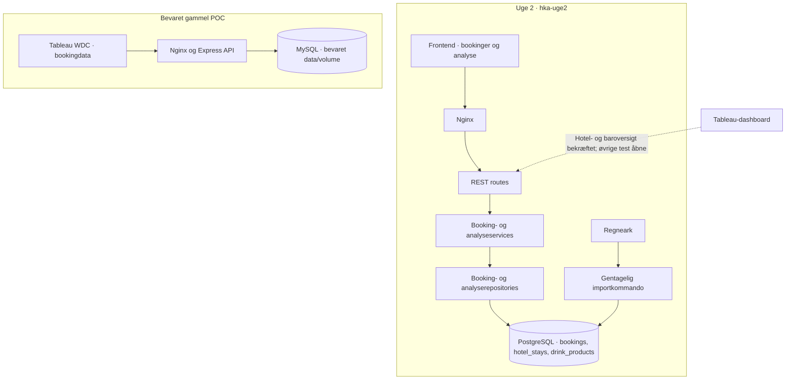

# Hotel Kong Arthur

Studieprojekt om bookingadministration og visualisering af hotel- og bardata.
Uge 2 bruger PostgreSQL i booking-backendens nye Compose-stack. Den gamle
MySQL-POC og dens containere/volume bevares separat til præsentationen.

**Gruppe:** Kenadid, Jonas, Jazmin, Nikolaj og Jannick.

## Status

Status kontrolleret 2. november 2026. Denne ZIP-mappe indeholder uge 2-kode,
dokumentation og den bevarede MySQL/Tableau-POC. Mappen har ikke Git-historik,
så branch- og commitforhold er ikke kontrolleret her. POC-opstartsvejledningen
gælder `compose.yaml`; uge 2-vejledningen gælder `compose.uge2.yaml`.

| Del | Nuværende status |
|---|---|
| Bookingadministration | Opret, vis, ret og slet gennem browseren og API'et. |
| PostgreSQL i uge 2 | Gemmer uge 2-bookinger i `hka-uge2_postgres_data`. |
| Analyse-API i uge 2 | Leverer førsteversionsberegninger fra de importerede PostgreSQL-tabeller. |
| MySQL-POC | Den gamle bookingdatabase og dens volumen bevares separat. |
| Inputvalidering | Kontrollerer navn, e-mail, værelsesnummer, datoer og status. |
| OpenAPI og Swagger UI | Dokumenterer booking- og analyse-endpoints. |
| Docker Compose | `compose.yaml` bevarer MySQL-POC'en; `compose.uge2.yaml` starter uge 2-stakken. |
| Tableau-forbindelse | WDC 2.3 er udvidet; hoteloversigt, baroversigt, hotelbeløb pr. land samt værelsestype/sæson vises korrekt. Manuel Refresh lykkedes for hoteloversigt, baroversigt og landefordeling. Øvrige tabeller er ikke færdigtestet. |
| Dashboard | Den gamle workbook bruger regneark til hotel/bar og API til booking. Uge 2 har en separat analysefane. |

Det samlede projekt er ikke færdigt. Uge 2-booking-CRUD og analyse-endpoints
kører gennem PostgreSQL og repositories, regnearkene er importeret gentageligt,
og analysefanen er implementeret. Brugeren har bekræftet de specifikke
browserkontroller, der er registreret i [Converge](specs/Converge); andre filtre
og Opdatér/genindlæsning er ikke bekræftet.

## Teknologi og arkitektur

- **Backend:** JavaScript, Node.js og Express.
- **Database:** PostgreSQL 16 med `pg` i uge 2; MySQL 8.0 bevares til den gamle POC.
- **Frontend:** HTML, CSS og JavaScript serveret af Nginx.
- **Dokumentation:** OpenAPI i YAML og Swagger UI i Express.
- **Analyse:** Tableau Public/Desktop og egen Web Data Connector 2.x.
- **Drift:** Docker Compose.



I uge 2 sender Nginx `/api/` til Express-ruter. Ruterne kalder services, som
validerer input og styrer beregningsreglerne; services kalder repositories,
der ejer al SQL og bruger uge 2-PostgreSQL. Importkommandoen indlæser
regnearkene i separate tabeller. Tableau-WDC/MySQL-forbindelsen er den gamle
POC. Samme WDC-teknik er udvidet med uge 2-tabeller; hotel- og baroversigter er
bekræftet i Tableau for hoteloversigt, baroversigt, beløb pr. land og
værelsestype/sæson; øvrige analysetabeller mangler kontrol.

## Gammel MySQL-POC: opstart

Dette afsnit gælder kun den gamle MySQL-POC. Uge 2 bruger `.env` fra
`.env.example`; overskriv ikke den fil med MySQL-indstillinger. Hvis den gamle
POC skal startes separat, læg dens eksisterende MySQL-indstillinger i en lokal
`.env.mysql`-fil. Ved genbrug af den gamle MySQL-volume skal de oprindelige
adgangskoder bevares.

Forudsætninger: Docker Desktop er installeret og startet, og I har en kopi af
POC-koden fra `Jazmin` eller en branch, hvor den er integreret.

1. Åbn projektmappen i VS Code.
2. Opret `.env.mysql` med MySQL-variablerne til den gamle POC:

   ```dotenv
   MYSQL_ROOT_PASSWORD=udskift_med_din_egen_root_adgangskode
   MYSQL_PASSWORD=udskift_med_din_egen_app_adgangskode
   MYSQL_USER=hoteluser
   MYSQL_DATABASE=hotel_db
   ```

   `.env.mysql` er dækket af `.gitignore` og må ikke deles eller uploades.

3. Kør i terminalen fra projektroden:

   ```sh
   docker compose --env-file .env.mysql -f compose.yaml up --build -d
   ```

4. Åbn brugerfladen og Swagger UI med adresserne nedenfor.

MySQL kører internt i Docker-netværket. Der kræves ikke en ledig værtsport 3306.
Tableau åbnes separat på brugerens computer og startes ikke af Compose.

| Funktion | Adresse |
|---|---|
| Bookingbrugerflade | http://localhost:8080 |
| Swagger UI | http://localhost:8080/api-docs/ |
| API gennem Nginx | http://localhost:8080/api/bookings |
| Direkte API | http://localhost:3000/api/bookings |
| Backend healthcheck | http://localhost:3000/health |
| Tableau-connector | http://localhost:8080/tableau.html |

Repoet har flere Compose-filer med forskellige navne. Denne vejledning bruger
udtrykkeligt `compose.yaml` fra POC'en.

## Booking-API

| Metode | Endpoint | Funktion |
|---|---|---|
| GET | `/api/bookings` | Hent bookinglisten. |
| GET | `/api/bookings/{id}` | Hent én booking. |
| POST | `/api/bookings` | Opret en booking. |
| PUT | `/api/bookings/{id}` | Erstat bookingens redigerbare felter. |
| DELETE | `/api/bookings/{id}` | Slet en booking. |

Inputfelter: `guestName`, `email`, `roomNumber`, `checkIn`, `checkOut` og `status`.
Datoer sendes som `YYYY-MM-DD`; afrejse skal være efter ankomst.

Status kan være `confirmed`, `cancelled`, `checked_in` eller `checked_out`.
POST bruger `confirmed`, hvis status udelades. PUT kræver hele det redigerbare
feltsæt, også status. Se request- og response-skemaer i Swagger UI.

Gyldig oprettelse returnerer 201, hentning/opdatering 200 og sletning 204.
Ugyldige bookingfelter returnerer 400, ukendte booking-ID'er 404 og interne fejl
500. Systemet kontrollerer endnu ikke, om værelset findes, eller om to bookinger
overlapper; der er ingen implementeret 409-regel mod dobbeltbooking.

## Tableau og opdaterede data

1. Start POC'en med Docker Compose.
2. Åbn Tableau og vælg **Web Data Connector** i den version, hvor gruppens
   forbindelse er afprøvet.
3. Indtast `http://localhost:8080/tableau.html` for den gamle POC.
4. Klik **Hent data til Tableau**, og vælg tabellen **Hotellets bookinger**.
5. Brug **COUNT(Booking ID)** til at vise antal bookinger.
6. Efter ændringer: vælg det relevante dataudtræk under **Data → Refresh**.

Bookingtabellen sender Booking ID, Værelsesnummer, Ankomst, Afrejse, Antal
nætter og Status. Antal nætter beregnes som afrejse minus ankomst. Gæstens navn
og e-mail sendes ikke til Tableau gennem denne connector. Den samme WDC-fil
tilbyder også uge 2-analysetabeller, når den åbnes via uge 2-adressen nedenfor.

Forbindelsen er demonstreret med et bookingtal, der ændrede sig fra 3 til 4 efter
oprettelse og manuel Refresh. Det er et extract, ikke automatisk realtidsdata.
COUNT(Booking ID) tæller alle hentede bookinger, herunder aflyste, medmindre der
tilføjes et filter. Antal bookinger er ikke belægningsprocent.

WDC 2.x er en ældre connector-generation. Gruppens præcise Tableau-version skal
registreres og gentestes, før forbindelsen betragtes som reproducerbar på andre
computere. Tableau Public kan ikke selv opdatere publicerede WDC-extracts.
Automatisk opdatering kræver en særskilt, kompatibel opsætning og test.
Se [Tableaus WDC-dokumentation](https://help.tableau.com/current/pro/desktop/en-gb/examples_web_data_connector.htm).

## Dashboard og datakilder

De viste hotel- og baranalyser bruger datasættene
`international_names_with_rooms_1000.xlsx` og `drinks_menu_with_sales.xlsx`.
De ligger under `Datasets/` på main og er ikke med i den gennemgåede Jazmin-kopi.

Dashboardet viser blandt andet landekort, opholdslængder, omsætning pr.
værelsestype/sæson, omsætning pr. drik, bartotal og et separat API-bookingtal.
Ændringer i booking-API'et opdaterer ikke automatisk regnearksdiagrammerne.
Lande- og sæsonfelter findes endnu ikke i API'ets bookingmodel.

Den lokale Tableau-workbook skal deles som `.twbx` med gruppen; den findes ikke
i de gennemgåede commits. En delt workbook viser de gemte data. Ny hentning fra
API'et kræver, at modtagerens POC kører, og at Tableau-versionen understøtter
connectoren. `localhost` betyder altid den computer, programmet kører på.

### Uge 2-analyser i Tableau

Uge 2 genbruger den eksisterende Tableau Web Data Connector 2.3 i
`frontend/tableau.html` og `frontend/tableau.js`. Efter start af uge 2-stacken
åbnes denne præcise connectoradresse i Tableau:

```text
http://localhost:8081/tableau.html
```

Den aktuelle synlige connectorversion er `HKA-U2-2026.11.02.4`; HTML-siden
loader `tableau.js?v=HKA-U2-2026.11.02.4`, så den nye kode bruger en ny
script-URL. Siden viser både sideversion og **JavaScript version loaded**.
Under datahentning viser statuslinjen version og tabel-ID; fejl fanget af
connectoren viser samme oplysninger i fejlteksten.

Vælg **Hent data til Tableau**. Connectoren bevarer bookingtabellen og tilbyder
separate API-baserede tabeller for hoteloversigt, ophold pr. land, hotelbeløb
pr. land, værelsestype/sæson, top-land, top-værelsestype, gennemsnitlig
`Days Rented`, baroversigt, beløb pr. drink og cocktail/kaffe-andele. De hentes
fra `/api/analysis/` gennem uge 2's Nginx-proxy. Tableau modtager de beregnede
værdier; connectoren genberegner dem ikke.

Hotellets totalbeløb og barens totalbeløb ligger hver i en særskilt én-rækkes
tabel. Grupperede tabeller indeholder kun gruppebeløb; de gentager ikke totalen
på hver række. Brug derfor ikke en gruppetabel som kilde til at summere en
gentaget total. Førsteversionsbeløb er POC-antagelser uden dokumenteret år.

Den aktuelle opdateringsmetode er manuel **Data → [dataudtræk] → Refresh** i
Tableau efter at uge 2-API'et er opdateret. Automatisk refresh er ikke afklaret
med lærerne. WDC/connectoren og API-schemas er implementeret, men forbindelsen
er ikke markeret færdig. En teknisk harness har efter seneste frontend-build kørt
connectorens `getData` mod alle ti faktiske API-svar; alle leverede forventede
rækker og felttyper. Manglende felter giver en fejl med version og tabel-id i
stedet for en 0-værdi. Den oprindelige hoteloversigtsfejl skyldtes et ekstra
`data`-niveau i rækkemappingen og er rettet.

**Brugerbekræftet Tableau-test:** I workbooken `Hotel-Kong-Arthur-uge2-API`
med connectorversion `HKA-U2-2026.11.02.4` vises hoteloversigten korrekt:
1.000 ophold, 11.234.034 kr. og gennemsnit 5,379. Baroversigten viser korrekt
30 produkter, 179.958 enheder og 13.448.640,34 kr. Hotelbeløb pr. land samt
hotelbeløb pr. værelsestype/sæson vises også korrekt. Manuel Refresh lykkedes
uden fejl for hoteloversigt, baroversigt og landefordeling. De øvrige Tableau-
tabeller er ikke færdigtestet. U2-T8 er derfor delvist testet, ikke færdig.

## Stop, log og bevarelse af data

```sh
docker compose -f compose.yaml ps
docker compose -f compose.yaml logs --tail=100
docker compose -f compose.yaml down
```

`down` bevarer databasevolumen. Brug ikke `down -v`, hvis bookingerne skal bevares.
`mysql/init.sql` opretter skema og eksempelbookinger ved initialisering af en tom
databasevolumen. Det genindlæser ikke regneark ved hver opstart. Brug samme
projektmappe/Compose-projektnavn for at genbruge den eksisterende volumen.

## Uge 2: PostgreSQL-bookingprototype

Uge 2 bruger en separat Compose-fil og project name `hka-uge2` med den named
volume `hka-uge2_postgres_data`. Databasen offentliggør ingen værtsport. Backend
og frontend bruger egne værtsporte, så den gamle POC fortsat kan køre.

1. Kopiér `.env.example` til `.env`, og sæt en unik lokal `POSTGRES_PASSWORD`.
   `.env` er udelukket fra Git; del eller upload den ikke.
2. Start uge 2-tjenesterne:

   ```sh
   docker compose --env-file .env -f compose.uge2.yaml up --build -d
   ```

| Funktion | Uge 2-adresse |
|---|---|
| Bookingbrugerflade | <http://localhost:8081> |
| Analysefane | <http://localhost:8081/#analysis> |
| Booking-API gennem Nginx | <http://localhost:8081/api/bookings> |
| Direkte booking-API | <http://localhost:3001/api/bookings> |
| Swagger UI | <http://localhost:8081/api-docs/> |
| Backend healthcheck | <http://localhost:3001/health> |

Kontrollér tjenesterne med:

```sh
docker compose --env-file .env -f compose.uge2.yaml ps
```

Bookingskemaet og tabellerne til regnearksimport oprettes fra
`postgres/init.sql` på en tom PostgreSQL-volume. Backend-SQL ligger i
bookingrepository; validering og bookingregler ligger fortsat i servicen.

Uge 2-backenden bruger PostgreSQL, mens den gamle POC fortsat bruger sin
MySQL-container og data. Der er ikke migreret MySQL-bookinger. Regnearksimporten
skriver til `hotel_stays` og `drink_products`; de importerede hotelophold er
adskilt fra browserens `bookings`, fordi kilden ikke indeholder bookingdatoer
eller værelsesnumre. Ingen datoer, kalenderår eller sælgere tilføjes.

### Importér regneark til uge 2

Kør fra projektroden, mens uge 2 PostgreSQL er startet:

```sh
python3 scripts/import_datasets.py
```

Scriptet bruger eksplicit `compose.uge2.yaml` og containerens PostgreSQL-
forbindelse. Det kontrollerer kolonner, celletyper, obligatoriske værdier og
forventet rækkeantal før import. Fejl rapporteres med fil og Excel-rækkenummer,
og ugyldige kilderækker importeres ikke. Proveniensen er kildefil, ark og
Excel-rækkenummer; genkørsel opdaterer samme kilderække uden dubletter, mens
identiske værdier på forskellige rækker forbliver særskilte. De oprindelige
celleværdier gemmes i `raw_values` ved siden af de typede databasefelter.

Verificeret 2. november 2026: 1.000 hotelrækker, `SUM(Price) = 11.234.034,00
kr.`; 30 barprodukter, 179.958 solgte enheder og `SUM(Price × Units Sold) =
13.448.640,34 kr.` Databasetallene blev sammenholdt med en uafhængig beregning
fra XLSX-cellerne. Kommandoen blev kørt to gange med samme rækkeantal og
summer. Booking-CRUD blev derefter kontrolleret igen; testbookingen blev
slettet. Frontendens analysefane bruger relative `/api/analysis/`-kald og
formaterer beløb i danske kroner med to decimaler. Brug ikke `down -v` eller
prune-kommandoer; behold begge datavolumener.

### Analyse-endpoints

Alle endpoints bruger importerede PostgreSQL-data og returnerer `dataBasis`,
POC-antagelser, aktive filtre og beregningsresultat. Beløb er decimalstrenge i
DKK med to decimaler. Hotelarkets `Price` behandles som samlet pris pr.
registreret ophold; drinkarkets `Price` behandles som stykpris. Ingen endpoint
kalder beløb årsomsætning eller Helenes salg, og der beregnes ikke belægning.

| Endpoint | Indhold |
|---|---|
| `/api/analysis/hotel/summary` | Samlet `SUM(Price)`, registrerede ophold og gennemsnitlig `Days Rented`. |
| `/api/analysis/hotel/stay-counts-by-country` | Rækkeantal pr. land. |
| `/api/analysis/hotel/revenue-by-country` | `SUM(Price)` og opholdstal pr. land. |
| `/api/analysis/hotel/revenue-by-room-type-season` | Beløb pr. værelsestype og kildens sæson. |
| `/api/analysis/hotel/top-revenue?groupBy=country` | Land(e) med højest samlet beløb; medtager delte førstepladser. `groupBy=roomType` giver rangering pr. værelsestype. |
| `/api/analysis/hotel/average-stay-length` | Gennemsnitlig `Days Rented` pr. registreret række. |
| `/api/analysis/bar/summary` | Samlet `Price × Units Sold`, produktantal og antal solgte enheder. |
| `/api/analysis/bar/products` | Omsætning pr. drink. |
| `/api/analysis/bar/category-shares` | Cocktail-/kaffeandel efter `Units Sold`. |

Hotelendpoints accepterer relevante filtre `country`, `roomType` og `season`;
barens summary og produktliste accepterer `category`. Filterværdier valideres
mod de importerede værdier. Ukendte filtre/værdier giver HTTP 400. Et gyldigt
filter uden match returnerer nulmål eller tom liste. OpenAPI-eksempler og
fejlsvar findes i Swagger UI: <http://localhost:8081/api-docs/>.

Analysesiden ligger i samme frontend som bookinglisten: vælg fanen **Analyser**
eller åbn <http://localhost:8081/#analysis>. Der er kort, tabeller, filtre,
opdateringsknap, indlæsningsstatus og fejl-/tomvisning. Datagrundlag og
POC-antagelser hentes fra API-svarene. Drikkategorifilteret ændrer barbeløbet
og drinklisten; kategoriandelene viser altid hele datasættet.

Verificeret 2. november 2026 efter frontend-genbygning: analyseside, HTML,
JavaScript og CSS blev hentet via HTTP med status 200; frontendkoden bruger
relative API-kald og indeholder ingen hardkodede analysebeløb. Alle 10 analyse-
API-kald returnerede 200. Booking-CRUD blev særskilt API-testet (POST 201,
GET 200, PUT 200, DELETE 204), og testbookingen blev slettet. Safari blev
åbnet på analysesiden. Efterfølgende browserkontroller er bekræftet af brugeren:
analyseoversigtens totaler, filtre for Brazil og China, nulstilling til alle
lande med 1.000 ophold og 11.234.034 kr., Coffee-filterets barbeløb/produktliste
og uændrede hoteltal samt opret/redigér/slet af booking. Øvrige filtre og
Opdatér/genindlæsning er ikke bekræftet. Den tidligere automatiserede visuelle
kontrol blev ikke gennemført: skærmbilledetagning fejlede, og Safari DOM-
inspektion krævede en indstilling, som ikke blev ændret. Brugerens browserkontrol
er adskilt fra HTTP/API-resultaterne.

## Specifikationer og verifikation

| Dokument | Formål |
|---|---|
| [Specify](specs/Specify) | Samlede krav, user stories og acceptkriterier. |
| [Clarify](specs/Clarify) | Observeret løsning og åbne spørgsmål om data og beregninger. |
| [Constitution](specs/Constitution) | Arkitekturprincipper og projektets fælles rammer. |
| [Plan](specs/Plan) | Teknologi, arkitektur og næste udviklingstrin. |
| [Tasks](specs/Tasks) | Opgaver med implementeringsstatus og resterende arbejde. |
| [Converge](specs/Converge) | Samlet statuskontrol af implementering, tekniske tests, brugerbekræftelse og mangler. |
| `Feature/Implement.md` på Jazmin | Tidligere rapporterede bookingtests. |

Converge sammenholder krav med resultatet: Hvad virker, hvad er testet, og hvad
mangler? En planlagt funktion må ikke markeres færdig uden kontrol.

De historiske MySQL-POC-tests er beskrevet i `specs/Tasks` og
`Feature/Implement.md`; de er ikke genkørt i denne Converge. Uge 2-importens
rækkeantal og summer blev kontrolleret ved to importkørsler. Uge 2-browserens
bekræftede handlinger står særskilt fra de tekniske API-tests i Converge.

## Resterende arbejde

- Afprøv de øvrige analysetabeller i Tableau; hoteloversigt, baroversigt, beløb pr. land og værelsestype/sæson er allerede brugerbekræftet.
- Skaff daterede hotelrækker og aftal rapporteringsår/indregningsregel, før årsomsætning kan beregnes.
- Skaff transaktionsdato og sælgeridentitet samt en dokumenteret identitetsregel, før Helenes salg eller kategoriandel kan beregnes.
- Skaff værelses-ID, bookingdatoer/status, kapacitet og tilgængelighedsregler; aftal belægningsformel og periode før implementering.
- Afklar den faktiske forretningsbetydning af `Price`; den nuværende betydning som samlet opholdsbeløb/stykpris er alene en POC-antagelse.
- Gentag uge 2-opstart og import fra en frisk kopi, og kontrollér `.env.example`/`.gitignore` samt Tableau-workbook på en anden gruppedeltagers computer.
- Browserbekræft øvrige analysefiltre og Opdatér/genindlæsning. Kategoriandele og gennemsnitlig `Days Rented` er allerede teknisk kontrolleret mod kildedata; brugerens browserkontrol af disse visninger er ikke registreret.

Se [CONTRIBUTE.md](CONTRIBUTE.md) for samarbejde. Gruppen skal kunne forklare
og gennemgå både AI-genereret kode og de valgte beregninger.
